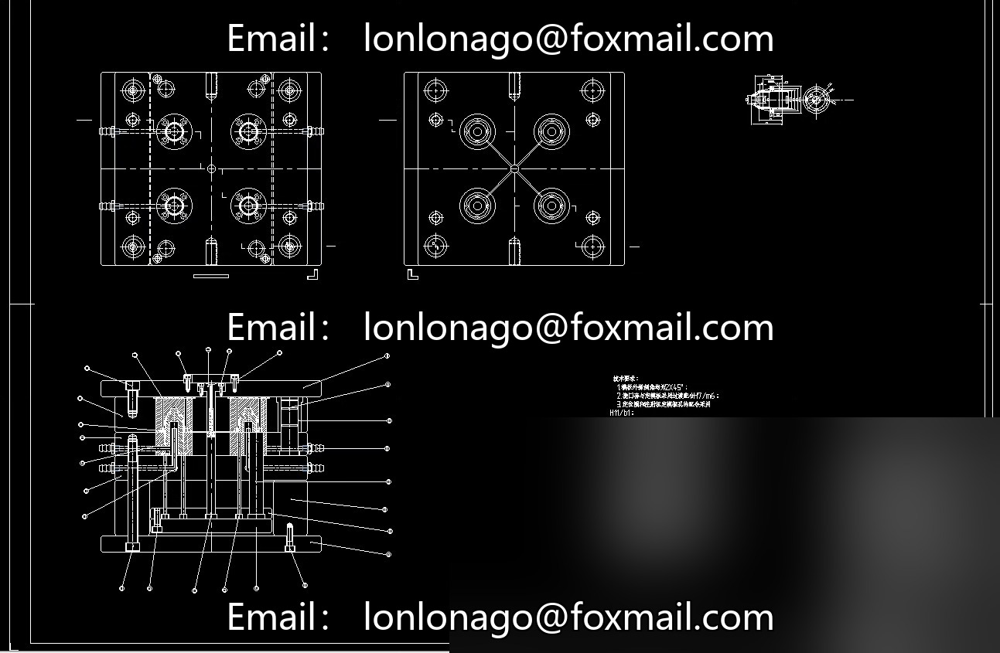
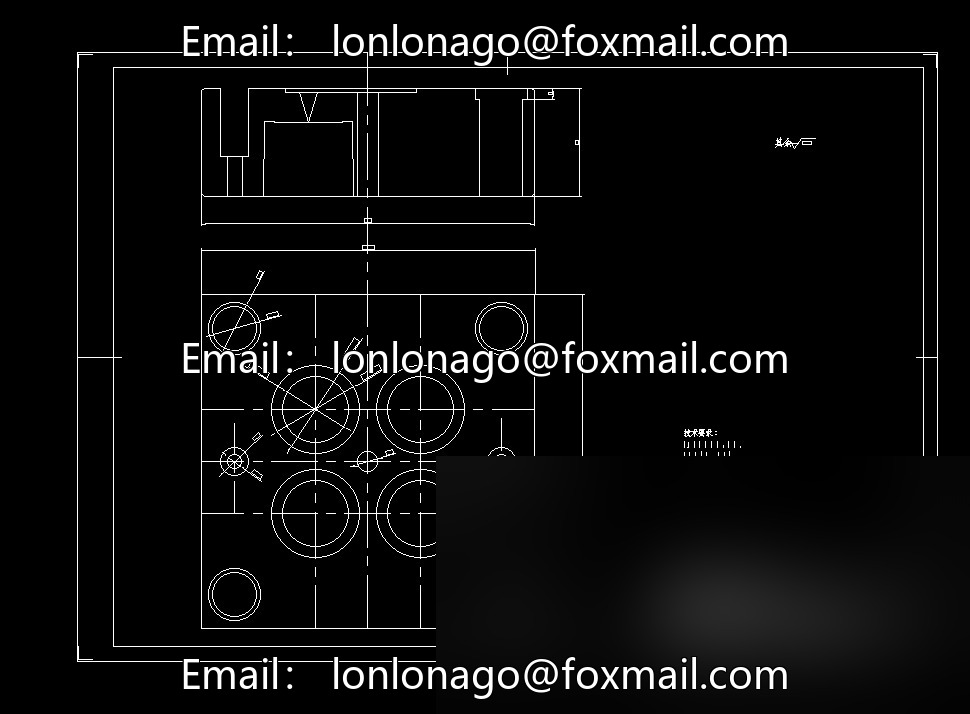
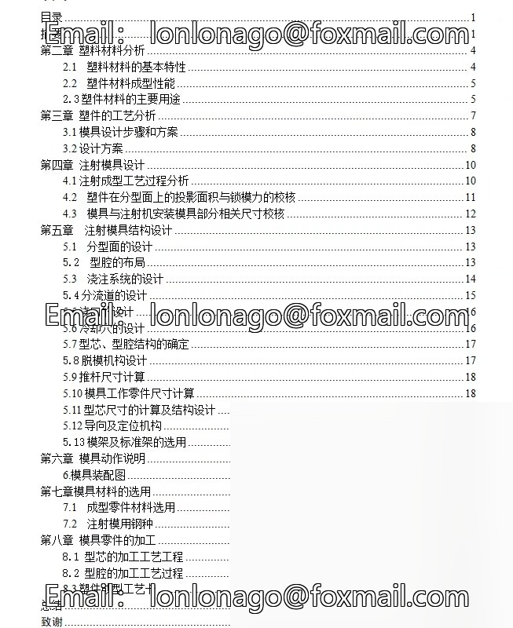
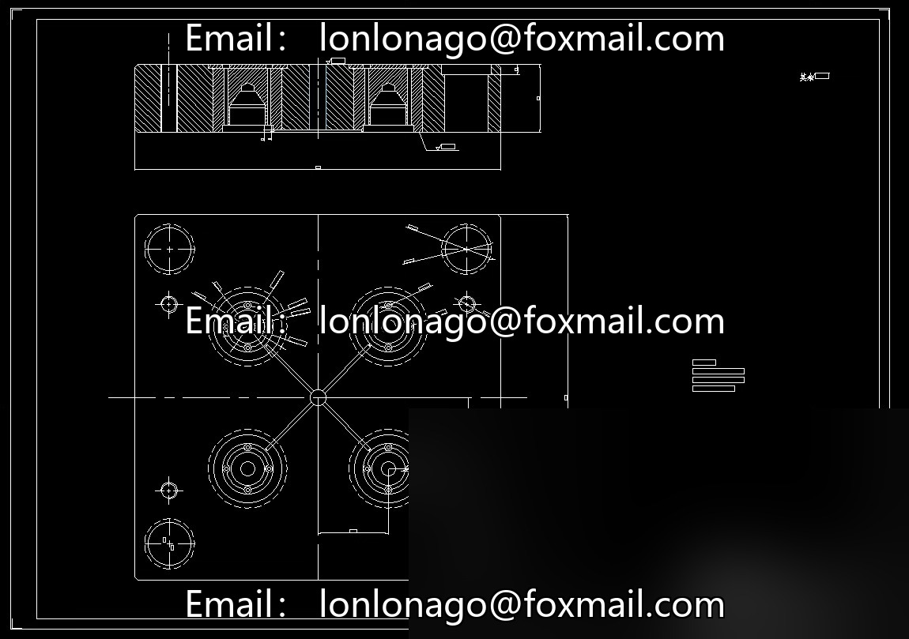
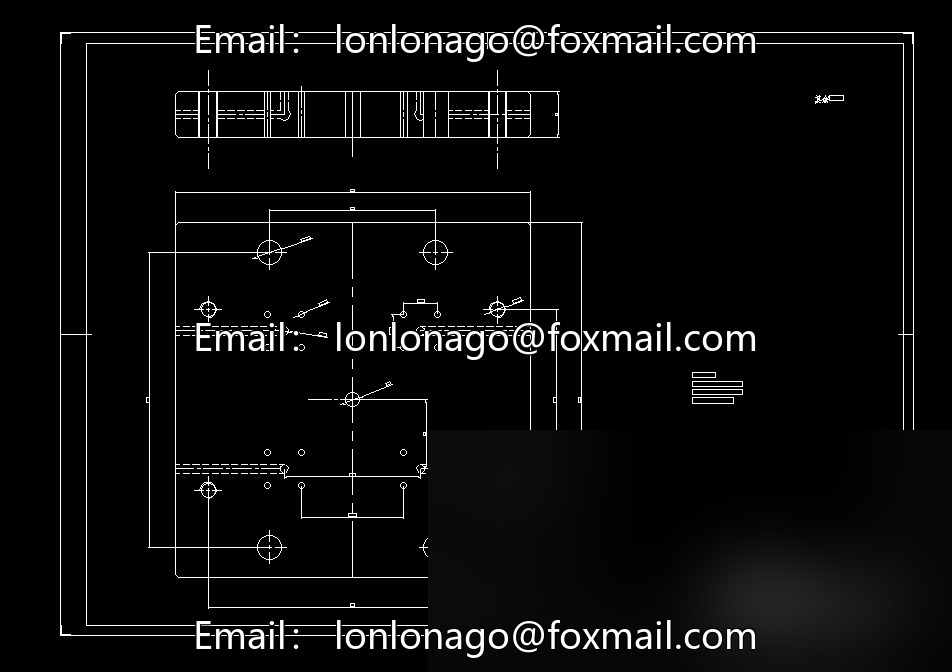
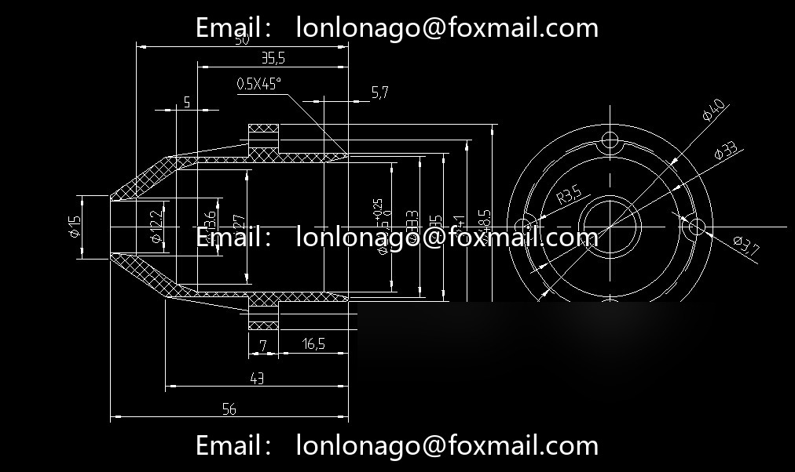

# Plastic protective shell mold design plastic protective shell mold design diagram plastic protective shell mold design

## Body

Plastic protective shell mold design; plastic protective shell mold design drawing; plastic protective shell mold design CAD drawing
90 Selection of part design dimensions. The mold adopts one-outline-two-part, side-inlet feeding, designs ejector system and cooling system, provides CAD two-dimensional assembly drawing, selects reasonable machining method of the mold.
Contains assembly drawing, part drawing and design description

The design covers mold design drawings, CAD drawings, assembly drawings, part drawings, and design descriptions; it also provides guidance on casting part dimensions and manufacturing methods.

<!-- AI_ENRICHED -->

## Images

## Payment

Here is a pay link on Stripe ( https://buy.stripe.com/3cs8yP7sY87d0vu9AB ). Please contact me lonlonago@foxmail.com after funding $89, and I will send you a complete data files , thank you!

